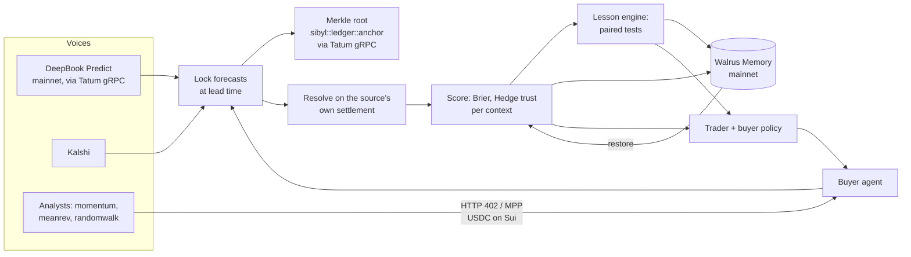

# Sibyl

**A BTC forecasting council that remembers who was right.**

Several voices forecast the same question, "BTC above K at time T?": the DeepBook Predict market on Sui, Kalshi, and three paid AI analysts. Sibyl commits every forecast on chain before expiry, scores each voice when the event settles, and keeps what it learns in **Walrus Memory**: who to trust in which market context, tested lessons, and its trading policy. It pays analysts per signal in USDC over **MPP on Sui**, but only when its memory says the signal is worth the price. All Sui traffic goes through **Tatum's Sui gRPC gateway**.

Before it trades, Sibyl **recalls** similar past situations from Walrus Memory and asks: "when the council disagreed with the market like this before, who was right?" Wipe its local beliefs, and it rebuilds them from Walrus and makes the same next decisions. There is an "Amnesia test" button on the dashboard, or run `pnpm restore-test`.



## How memory changes behaviour

| Memory (namespace) | What it holds | What it changes |
| --- | --- | --- |
| `sibyl:trust` | Hedge weights per context (horizon x vol regime x session), versioned | How much each voice counts in the ensemble; what each analyst can charge (`0.01 x (0.5 + trust)` USDC) |
| `sibyl:lessons` | Promoted and retired hypotheses with p-values | "A beats B here" removes B from the trade signal (and stops buying it); "V is biased" subtracts the bias; "V is overconfident" shrinks V toward 0.5 |
| `sibyl:policy` | Edge threshold per context, with the reason | The trader needs a bigger edge where Sibyl itself has been miscalibrated |
| `sibyl:payments` | Buy/skip decisions with value of information | Audit trail of the buyer agent |
| `sibyl:episodes` | One line per resolved 5m/15m event, starting with the situation in words and whether the council or the market was right | **Recalled at every 5m/15m forecast lock.** The council's record in the 10 most similar situations moves the trade threshold for that event (from -2 to +4 points) |
| `analyst:<name>` | Each analyst's own lessons | The analyst shrinks its own calls where it learned it was overconfident |

Every memory is a readable line plus a JSON tail, for example:

```
TRUST v17 ctx=5m/high/us kalshi 0.41 deepbook 0.33 analyst:momentum 0.12 (n=212) | {"kind":"trust",...}
LESSON PROMOTED "deepbook beats analyst:momentum in 5m/low/asia by 0.0110 Brier" p=3.1e-04 n=184 effect: leave analyst:momentum out of the trade signal and stop buying it in 5m/low/asia | {...}
```

Example recall at lock time (shown live on the dashboard):

```
situation: 15m BTC, low volatility, asia session: council far below the market; market expects down
recalled:  10 similar episodes, council right in 10 -> edge needed to trade -2.0pt
```

A **baseline** ensemble (equal weights, no lessons) is scored and paper-traded on the same events, so the dashboard shows what memory adds.

## The learning loop

1. **Discover.** Every DeepBook market with a reference price, plus every Kalshi 15-minute market, becomes an event. The cadence comes from the market's own window on chain.
2. **Lock.** At a fixed lead time (T-40s for 1m, T-4m for 5m, T-10m for 15m) each voice is sampled. Quotes for another strike are mapped with a lognormal shift, using the volatility implied by DeepBook's own pricer. The memory and baseline ensembles are locked too.
3. **Commit.** Every 15 seconds the newly locked forecasts are hashed into a Merkle tree. The root is emitted on Sui by `sibyl::ledger::anchor`, which aborts unless the window has already closed. In testing, every forecast was on chain before its event expired.
4. **Resolve.** Each event settles on its source's official result: DeepBook's on-chain settlement (Pyth) or Kalshi's result (CF Benchmarks).
5. **Learn.** Brier scores feed Hedge weights per context. This uses `eta = sqrt(8 ln N / t)` with sleeping experts, so a silent voice is neither rewarded nor punished. Every 5 resolutions the lesson engine runs paired tests (n >= 30, Bonferroni). A lesson is promoted at p < 0.05/m and retired when its p rises above 0.2 or the effect flips.
6. **Remember.** Snapshots, lessons, policy and episodes go to Walrus through an outbox (bulk writes, retries, a daily budget).
7. **Recall.** At each 5m/15m lock, Sibyl writes the situation as a sentence: horizon, volatility, session, how far the council is from the market, and where the market leans. It runs semantic recall over `sibyl:episodes` and keeps comparable episodes (same horizon, same side of the market). It needs at least 5 of them before the record changes anything.
8. **Act.** The buyer pays an analyst only if its value of information exceeds the price. Value of information is the Brier gain of the ensemble with versus without that analyst on past events. The buyer also explores 10% of the time, and never buys an analyst a lesson has excluded. The trader buys the cheap side on DeepBook when `|ensemble - market|` exceeds the context's learned threshold, sized at quarter Kelly.

## Run it

Node 22.5+ and pnpm.

```bash
pnpm install
cp .env.example .env      # works with no keys: public endpoints, mock memory, dry payments
pnpm start                # http://localhost:8787
```

| Script | What it does |
| --- | --- |
| `pnpm start` | Worker + API + dashboard |
| `pnpm probe` | Checks Tatum (both networks), DeepBook, Kalshi, Coinbase and Walrus once |
| `pnpm memwal:selftest` | Real Walrus round trip in `sibyl:selftest` (2 writes) |
| `pnpm restore-test` | Checkpoint, wipe local beliefs, rebuild from Walrus, diff the next decisions (also a dashboard button) |
| `pnpm backfill [days]` | Replay settled Kalshi 15m markets through the same pipeline (stop the app first) |
| `pnpm publish:move` | Build and publish `move/sibyl` with the trader key through Tatum |
| `pnpm typecheck` / `pnpm test` | Strict TypeScript and unit tests (math, Hedge, lessons, Merkle, Kalshi, buyer) |

### Configuration

- **Tatum.** `TATUM_API_KEY` sends every Sui read and write through `sui-<network>-grpc.gateway.tatum.io` over native gRPC (`@protobuf-ts/grpc-transport`). One shared limiter (about 3 requests/s) covers both networks, with retries on 429 / `RESOURCE_EXHAUSTED`, a 20s deadline per call, and counts shown in the UI.
- **Tatum checkpoint stream.** `src/sources/stream.ts` keeps two `SubscriptionService/SubscribeCheckpoints` streams open through Tatum: DeepBook's `MarketSettled` on mainnet and Sibyl's own `Anchored` on testnet. (Tatum does not allow `SubscribeEvents`; the checkpoint filter selects checkpoints that contain those events, and Sibyl picks the events out.) A settlement resolves the event about 2.5s after expiry, where polling took 30s or more. Each anchor is marked `confirmed` when its event is seen on chain. Streams reconnect with backoff, and polling stays on as the fallback. The dashboard shows a live feed.
- **Networks.** Voices read DeepBook on **mainnet** (`SUI_READ_NETWORK`). Anchors, payments and trades go to **testnet** by default (`SUI_WRITE_NETWORK`); set it to `mainnet` to go live. Walrus Memory is always mainnet.
- **Walrus Memory.** Create an account at [memory.walrus.xyz](https://memory.walrus.xyz). Add a delegate key (`pnpm setup:memwal` generates one locally), then set `MEMWAL_KEY` and `MEMWAL_ACCOUNT_ID`. Use `MEMORY_NAMESPACE=sibyl-dev` for test runs.
- **Analyst price level.** Analysts take drift and volatility from Coinbase candles, but their price level from DeepBook's on-chain forward (Pyth). The two feeds differ by a few dollars, and on 1-minute questions that gap alone made analysts confidently wrong.
- **Payments.** Set `PAYMENTS_MODE=live` with `BUYER_PRIVATE_KEY`, `ANALYST_RECIPIENT_ADDRESS` and `MPP_SECRET_KEY`. Testnet uses Circle testnet USDC. Payments go out one at a time through Tatum. The server verifies each payment itself (no facilitator) against the public fullnode, because `@suimpp/mpp` verifies over gRPC-web. Payment digests are stored in SQLite, so a payment cannot be replayed after a restart. Caps: `MAX_PAYMENT_USDC`, `MAX_DAILY_PAYMENTS_USDC`.
- **Anchors.** Set `ANCHOR_MODE=live` with `TRADER_PRIVATE_KEY` and `SIBYL_PACKAGE_ID`. Each anchor costs about 0.001 SUI.
- **Trading.** `TRADE_MODE=paper` runs both books. `live` places queued DeepBook orders (`planMint` + `enqueuePlan`), capped by `MAX_STAKE_USDC` and `MAX_DAILY_USDC`. Defaults never move funds.

### Deployed

- Move package (testnet): `0x8a7c0731abe03a18b2f670d26c3e425b90cbaaee32c41742f7f58449075b4ecc` ([publish tx](https://suiscan.xyz/testnet/tx/9PbkqFLoo1SQKbUuSyQ1AfJzTsn64EHRQijqDDAZB6VJ))
- Example anchor: [7BXmhVUf…](https://suiscan.xyz/testnet/tx/7BXmhVUfouqd5bSs9z99P7DpHnzMxC14aX5TrPZjxgeM). Example MPP payment: [Amexi8J3…](https://suiscan.xyz/testnet/tx/Amexi8J3TDcacgSkHtBnKTSFaiT4CEMEvq4Yjmv5DndU)

### Backfill (historical replay)

Lessons need 30 paired outcomes per context, which takes days of live data. `pnpm backfill 6` replays the last 6 days of settled Kalshi 15-minute markets in order:
- Kalshi's price at T-10m comes from its one-minute candles.
- Analysts run on the Coinbase candles that existed at that moment, so nothing is known in advance.
- Each event resolves on Kalshi's official result.
- Everything after that goes through the same scoring, Hedge, lesson and memory code as live events.

Backfilled events are marked `backfill:` and `BACKFILL` in memory. They are never anchored, since they are already in the past, and never paid for. DeepBook has no price history, so it is absent from them. On 7 Nov the replay covered 568 events and produced 7 promoted lessons, for example "kalshi beats analyst:meanrev in 15m/mid/us by 0.0517 Brier (p=1.4e-3, n=45)".

## Dashboard

The dashboard leads with the answer, then the reasons, then the proof:
- **Live:** a big countdown and the five stages of a call (sampling, locked, on Sui, closed, settled); a live BTC price chart with the strike, lock, Sui commitment and close marked; a result banner when the call settles; a grid of the last 40 results with hit rates for Sibyl, the market and no-memory. Then the next question, with Sibyl's probability against the market and against the no-memory baseline, and what it is doing about the gap. Below that: who it listened to (trust), what it remembered (Walrus recall), what it paid for (MPP), whether it is any good, what it has learned, and how to verify it (Sui commitment, Walrus blob, wipe-and-rebuild button).
- **Track record, Lessons, Payments, Proofs:** one tab each.
- **Under the hood:** the engineering views (all voices, Tatum stream, trust heatmap with time slider, raw memories).

Tabs have deep links, for example `/#lessons`.

## API

`/api/state` · `/api/council` (live events with every voice, both ensembles, edge and payments) · `/api/events?status=resolved` · `/api/event/:id` · `/api/proof/:forecastId` (Merkle proof checked server-side, plus the anchor tx) · `/api/trust?history=true` · `/api/brain-diff?from=&to=` · `/api/lessons` · `/api/memories?ns=` · `/api/payments` · `/api/trades` · `/api/curve` (rolling Brier with bootstrap bands) · `/api/trust-at?at=` (beliefs at a past time, for the time slider) · `POST /api/amnesia` (pause, checkpoint, wipe, restore from Walrus, diff) · `/api/chain-events` (live feed from the Tatum stream) · `/signal/:agent?event=` (MPP-paid analyst signal).

## Code map

| Judging criterion | Where |
| --- | --- |
| Walrus Memory: meaningful use, restore | `src/brain/recall.ts` (semantic recall changes trades), `src/brain/` (`memwal.ts` outbox, `brain.ts` schema and restore, `lessons.ts`, `restore-check.ts`) |
| Tatum Sui RPC | `src/sui.ts` (native gRPC, shared limiter), `src/sources/stream.ts` (checkpoint streaming), `src/sources/deepbook.ts`, `src/anchor.ts`, `scripts/publish-move.ts` |
| Agent payments (MPP on Sui) | `src/payments/server.ts` (seller, trust-based price), `src/payments/buyer.ts` (value of information, exploration, caps) |
| Learning and its visible effect | `src/scoring.ts` (Hedge, ensembles, corrections), `src/brain/lessons.ts`, `web/index.html` |
| Forecast commitment | `src/merkle.ts`, `src/anchor.ts`, `move/sibyl/sources/ledger.move` |

## Limits

- DeepBook testnet has no public USDC faucet, so trading stays on paper unless `SUI_WRITE_NETWORK=mainnet`.
- Pyth Hermes now requires an API key, so analysts read one-minute candles from Coinbase. Events still settle on the venue's own oracle.
- Polymarket is off by default (`ENABLE_POLYMARKET=true`) because its API is geo-blocked in some regions.
