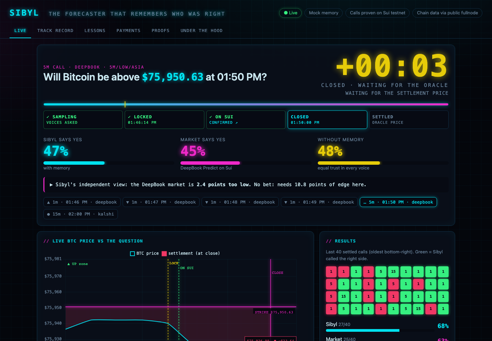
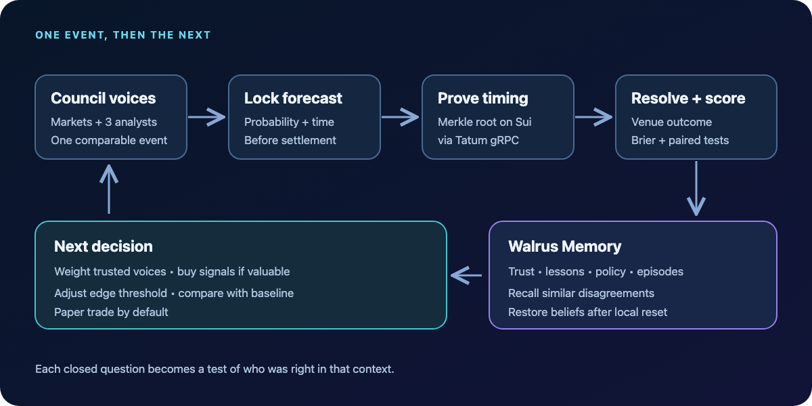
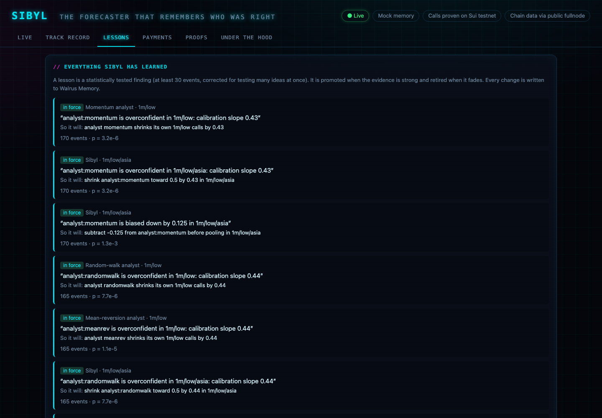
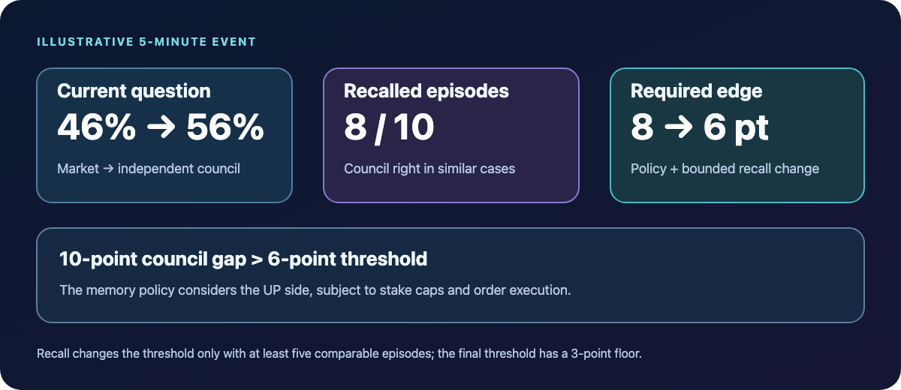

*A technical walkthrough of contextual trust, Walrus Memory, paid analyst signals, and verifiable forecasts on Sui.*

*Sibyl shows its probability beside the market and the equal-weight baseline, then explains its decision and the event's timeline.*

Suppose three analysts and two prediction markets answer the same question: **Will BTC finish above a particular price at a particular time?** Their probabilities disagree. Which one should an agent trust, and should it pay for another opinion? A single global ranking cannot answer that: an analyst that performs well during quiet Asian trading hours may fail in a volatile US session.

Sibyl is an experimental forecasting council built to make those choices from its own record. It locks each probability before the outcome is known, scores the voices after settlement, stores its beliefs and evidence in Walrus Memory, and uses those memories in the next decision. The project combines [DeepBook Predict](https://www.docs.sui.io/onchain-finance/deepbook/deepbook-predict/), [Tatum's Sui gRPC gateway](https://docs.tatum.io/changelog/sui-grpc-available-tatum), [MPP payments in USDC on Sui](https://github.com/t2000-afi/suimpp), and a small Move contract for proof of timing.

**In brief:** Every event has a strike, an expiry, and an outcome. Sibyl gathers comparable probabilities, learns a trust weight for each voice in each market context, recalls similar past disagreements, and trades only when its independent view clears a learned edge threshold. A separate equal-weight baseline runs on the same events so the effect of memory can be measured.

*Figure 1. The result of one event becomes evidence for the next. Walrus stores both the belief state and the episodes that can change a later trade threshold.*

## What exactly is Sibyl forecasting?

Each question is a binary event: **“BTC price at expiry T is above strike K.”** Sibyl records the event's source, horizon, strike, expiry, and settlement oracle. DeepBook Predict supplies live onchain markets; Kalshi supplies additional 15-minute events. The available horizons and markets depend on the venue at the time.

The council's voices are the DeepBook market price, the Kalshi market price when there is a comparable market, and three deliberately simple analysts:

| Voice | What its probability represents |
| --- | --- |
| DeepBook Predict | The market-implied probability for a Sui BTC contract. |
| Kalshi | A probability inferred from the market's yes bid and ask prices. |
| Momentum analyst | A model that lets part of the recent five-minute drift persist. |
| Mean-reversion analyst | A model that lets price move back toward its 20-minute average. |
| Random-walk analyst | A driftless volatility-based benchmark. |

The analysts use one-minute Coinbase candles for drift and volatility. For live DeepBook questions, they anchor the price level to DeepBook's onchain forward. That detail matters: a small Coinbase-versus-Pyth price gap can dominate a one-minute question near its strike. Sibyl learned this during implementation, so the analyst's *shape* comes from candles while its *starting level* follows the market being forecast.

Market quotes are not automatically interchangeable. Kalshi and DeepBook can use different strikes, expiry times, and settlement oracles. Sibyl maps a quote to the target question only when the expiries are within 60 seconds and applies a volatility-based strike adjustment. It records the oracle alongside each voice. A mapped probability is an approximation, not a claim that two venues settle identically.

## How does the council learn whom to trust?

It scores each locked forecast against the eventual binary outcome using the **Brier score**: `(probability − outcome)²`, where the outcome is `1` for yes and `0` for no. If a voice said 70% and yes occurred, its loss is `0.09`; if no occurred, its loss is `0.49`. Lower is better. Because both forecasts must refer to the same event, this score also lets Sibyl compare two voices on paired outcomes.

Trust is specific to a **context**: horizon × volatility regime × trading session. For example, `5m/high/us` means a five-minute event in high volatility during the US session. Sibyl updates the voices' weights after each resolution with a multiplicative rule: `new weight ∝ old weight × exp(−learning rate × Brier loss)`. A voice that did not speak on an event is left alone. A small weight floor lets a weak voice recover if conditions change.

The ensemble pools the corrected probabilities in log-odds space. It also keeps an **equal-weight baseline** without lessons. Both are locked before resolution and scored afterward. This avoids claiming that memory helped merely because a later chart looks better: the comparison is made on the same questions at the same time.

Trust weights adapt continuously, but a single run of luck should not create a permanent rule. Sibyl therefore has a separate lesson engine. It tests whether one voice beats another on paired Brier scores, whether a voice is systematically biased, and whether its probabilities are overconfident. A candidate needs at least **30 observations** and must clear a multiple-testing-adjusted significance threshold before promotion. A promoted lesson can exclude an inferior voice from the trade signal, subtract a measured bias, or shrink an overconfident forecast toward 50%. It can later be retired when the evidence fades or reverses. The analyst models also keep their own self-calibration lessons.

*The Lessons view shows each finding, the evidence behind it, and how it changes future forecasts.*

## What does Walrus Memory actually change?

[Walrus Memory](https://docs.wal.app/walrus-memory/sdk/examples) is the durable record of Sibyl's learned state and resolved episodes. The project writes readable lines with a machine-readable JSON tail into separate namespaces: `sibyl:trust`, `sibyl:lessons`, `sibyl:policy`, `sibyl:episodes`, `sibyl:payments`, and one namespace per analyst. The local SQLite database supports the running service and dashboard; Sibyl can rebuild its beliefs from Walrus with the restore test.

The most direct memory-driven decision happens **before a 5- or 15-minute forecast locks**. Sibyl describes the situation in plain language, such as “5m BTC, high volatility, US session: council far above the market; market near a coin flip.” It asks Walrus for semantically similar episodes, then keeps only comparable examples: the same horizon and the same direction of disagreement. If fewer than five survive, recall makes no adjustment.

With enough examples, Sibyl counts how often the council's side was right. That hit rate moves the required trading edge by at most **−2 to +4 probability points**. A strong recalled record can lower the threshold; a poor one raises it. The adjustment is bounded and cannot take the final threshold below the system's fee-aware minimum. The recalled episodes are shown alongside the decision, so the reason is inspectable.

*Figure 2. Illustrative numbers: a 10-point disagreement clears a 6-point threshold after recall. The actual threshold and history are recalculated for each event.*

This is a stronger use of memory than simply displaying an archive. If the local belief tables are wiped, Sibyl restores trust, lessons, and policy from Walrus, then compares the rebuilt next decisions with the checkpoint. The dashboard exposes that as an **Amnesia test**. The episodes supply a second path from storage to behavior: a semantic recall result can change the threshold for one specific event.

## Why pay for a forecast at all?

An analyst signal has a price, so Sibyl treats it as a purchase decision. The seller exposes an MPP-protected HTTP endpoint. A live buyer receives the `402` challenge, pays USDC over Sui, and receives the signal after payment verification. The price is tied to the analyst's remembered trust score: `0.01 × (0.5 + trust)` USDC per paid call. One-minute samples are free; the paid horizons are longer.

Before buying, Sibyl estimates the analyst's **value of information** from past resolved events: how much the ensemble's Brier loss changed *with* that analyst compared with *without* it. It converts the average gain into an approximate USDC value using the configured stake, then compares it with the quoted price. If there are too few samples, it buys during cold start. Otherwise it may still explore on a deterministic 10% of otherwise rejected calls, so it can keep learning. A promoted lesson can exclude an analyst from purchase in a context. Per-signal and daily caps constrain spending.

The seller's payment digest is stored in SQLite to reject replay after a restart. Tatum handles Sui reads and writes when configured; MPP's server-side verification uses a public gRPC-web fullnode because that library's verifier does not accept the native Tatum gRPC transport. This is an implementation boundary worth making visible rather than hiding behind the phrase “all onchain.”

## How can a reader verify a forecast existed before settlement?

Sibyl hashes each locked forecast as a leaf in a Merkle tree. It submits the tree root, leaf count, and time window to the `sibyl::ledger::anchor` Move module on Sui. The contract checks that the window has closed before emitting an anchor event. For a forecast, the proof API returns the leaf, sibling hashes, root, and transaction digest; a reader can recompute the path and compare the root with the chain event. Walrus memory references then show what Sibyl learned from the resolved event.

This proves **commitment to the recorded forecast**, provided the anchor transaction landed before that event's expiry. It does not prove that the forecast was accurate, and the chain does not compute the Brier score. The project's test run reported **38 of 38 forecasts anchored on testnet before expiry** and **nine real MPP payments**. These are run-specific checks, not a guarantee about future uptime or prediction quality. The [example anchor transaction](https://suiscan.xyz/testnet/tx/7BXmhVUfouqd5bSs9z99P7DpHnzMxC14aX5TrPZjxgeM) and [example MPP payment](https://suiscan.xyz/testnet/tx/Amexi8J3TDcacgSkHtBnKTSFaiT4CEMEvq4Yjmv5DndU) are available to inspect.

## How does Sibyl decide to trade?

For five-minute DeepBook events, Sibyl compares the market probability with its **independent** council probability; DeepBook's own quote is removed from the trade signal so the market does not vote on whether it is mispriced. The gap must exceed a threshold learned from context and adjusted by recall. If it does, Sibyl chooses the side it believes is cheap and sizes the position with quarter-Kelly logic, bounded by per-trade and daily stake caps. An equal-weight, fixed-threshold baseline is paper-traded alongside it.

This remains an experiment. Short-horizon probabilities can be noisy, venue oracles can differ, orders can fail or move before execution, and historical replay cannot stand in for prospective results. The six-day Kalshi replay described in the README processed **568 settled events** and produced **seven promoted lessons**; those events were never paid for or anchored, because their expiry was already in the past. DeepBook was absent from that replay because the required price history was unavailable. The strongest evidence of a useful system is therefore the live, event-by-event comparison of Sibyl with its baseline, including costs and failed attempts.

## How can I try it?

With Node 22.5+ and pnpm, run `pnpm install` and `pnpm start`, then open `http://localhost:8787`. The dashboard shows the current question, each voice's probability, learned trust, recalled episodes, payment decisions, performance curves, and proof links. The `/api/state` endpoint exposes modes and health. The [README configuration guide](https://github.com/nancy197/sibyl/blob/main/README.md) covers setup for Tatum, Walrus, payments, anchors, and trading.

The central test is simple: after each settlement, can the council explain **what it believed, why it believed it, what actually happened, and which part of its next decision changed**? Sibyl's memory, payment, and proof layers exist to make those four answers inspectable.
